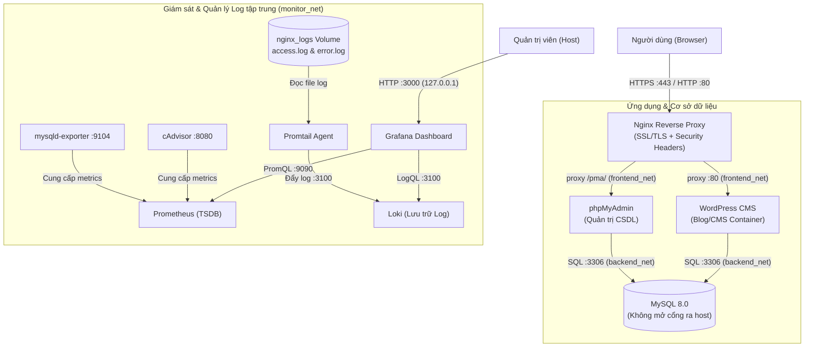

# Hệ thống Blog / CMS (WordPress) - Đề Tài 07

* **Môn học:** Triển khai và Quản trị Hệ thống Phần mềm
* **Mã số sinh viên (MSSV):** DTC245200570
* **Repository:** https://github.com/DTC245200570/Blog-CMS

Triển khai hệ thống Blog / CMS (WordPress) sử dụng Docker Compose, Nginx Reverse Proxy (SSL/HTTPS), tích hợp giám sát Prometheus, Grafana và quản lý log tập trung Loki + Promtail.

---

## 1. Kiến trúc hệ thống



---

## 2. Hướng dẫn cài đặt & chạy

### Bước 1: Tạo file cấu hình môi trường
```bash
# Linux/macOS
cp .env.example .env

# Windows PowerShell
Copy-Item .env.example .env
```
Mở file `.env` và thiết lập mật khẩu bắt buộc cho `MYSQL_ROOT_PASSWORD`, `MYSQL_PASSWORD`, `GRAFANA_ADMIN_PASSWORD`. Nếu để trống, Docker Compose sẽ báo lỗi và từ chối khởi động.

### Bước 2: Tạo chứng chỉ SSL (có SAN cho localhost)
- **Windows:**
  ```powershell
  .\nginx\ssl\generate-ssl.ps1
  ```
- **Linux:**
  ```bash
  chmod +x ./nginx/ssl/generate-ssl.sh
  ./nginx/ssl/generate-ssl.sh
  ```
*Lưu ý:* Chứng chỉ SSL tự ký (self-signed) được cấu hình Subject Alternative Name (SAN) cho `localhost` và `127.0.0.1`. Trình duyệt sẽ cảnh báo về cơ quan chứng thực (Untrusted CA), người dùng chọn "Tiếp tục truy cập" (Proceed to localhost) khi kiểm thử.

### Bước 3: Khởi chạy hệ thống
```bash
docker compose up -d
```

Kiểm tra trạng thái:
```bash
docker compose ps
```

---

## 3. Danh sách dịch vụ & Cổng truy cập

| Dịch vụ | URL | Tài khoản mặc định | Ghi chú |
|:---|:---|:---|:---|
| **WordPress** | `https://localhost` | Khởi tạo ở lần đầu truy cập | Cổng chính qua Nginx HTTPS |
| **phpMyAdmin** | `https://localhost/pma/` | Tài khoản MySQL trong `.env` | Định tuyến subpath qua Nginx |
| **Grafana** | `http://localhost:3000` | Cấu hình trong `.env` | Bind loopback `127.0.0.1` |
| **Prometheus** | `http://localhost:9090` | - | Bind loopback `127.0.0.1` |
| **Loki** | `http://localhost:3100` | - | Bind loopback `127.0.0.1` |

---

## 4. Các cấu hình bảo mật (Hardening)
- **Tách mạng nội bộ:** `frontend_net` (Nginx, WordPress, phpMyAdmin), `backend_net` (WordPress, phpMyAdmin, MySQL, Exporter), `monitor_net` (Prometheus, Grafana, Loki, Promtail, cAdvisor). Cổng MySQL (3306) không publish ra ngoài host.
- **Giới hạn phạm vi cổng quản trị:** Grafana (3000), Prometheus (9090), Loki (3100) chỉ bind trên loopback `127.0.0.1`, không mở ra mạng ngoài.
- **Nginx Security Headers:** Cấu hình `X-Frame-Options`, `X-Content-Type-Options`, `X-XSS-Protection`, `Strict-Transport-Security`, `Referrer-Policy`.
- **Giới hạn tài nguyên:** Đặt giới hạn `cpus` và `memory` cho các container trong `docker-compose.yml`.
- **Tách biệt cấu hình:** Toàn bộ thông tin đăng nhập, mật khẩu đưa vào `.env`, kiểm tra bắt buộc cấu hình trước khi khởi động.

---

## 5. Truy vấn LogQL mẫu trên Grafana
Truy cập Grafana > **Explore** > chọn data source **Loki**:
1. **Lọc log Nginx truy cập theo method GET:**
   ```logql
   {job="nginx"} |= "GET"
   ```
2. **Lọc các request phát sinh lỗi (status code >= 400):**
   ```logql
   {job="nginx"} | json | status >= 400
   ```
3. **Đo đếm tần suất truy cập web server (Requests/phút):**
   ```logql
   rate({job="nginx"}[1m])
   ```

---

## 6. Kiểm thử tự động
Chạy script kiểm tra hệ thống:
- **Windows (PowerShell):**
  ```powershell
  .\scripts\test-system.ps1
  ```
- **Linux / Git Bash:**
  ```bash
  chmod +x ./scripts/test-system.sh
  ./scripts/test-system.sh
  ```

---

## 7. Lịch sử cập nhật
Xem chi tiết tại [CHANGELOG.md](CHANGELOG.md).
